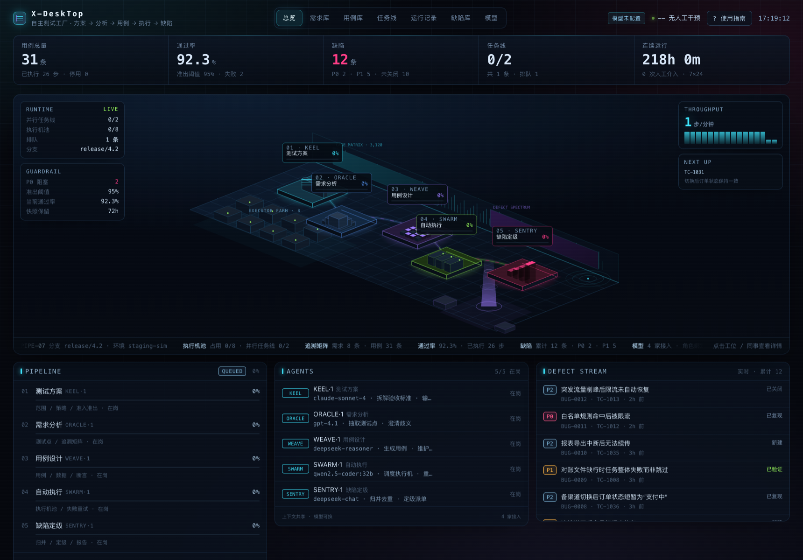
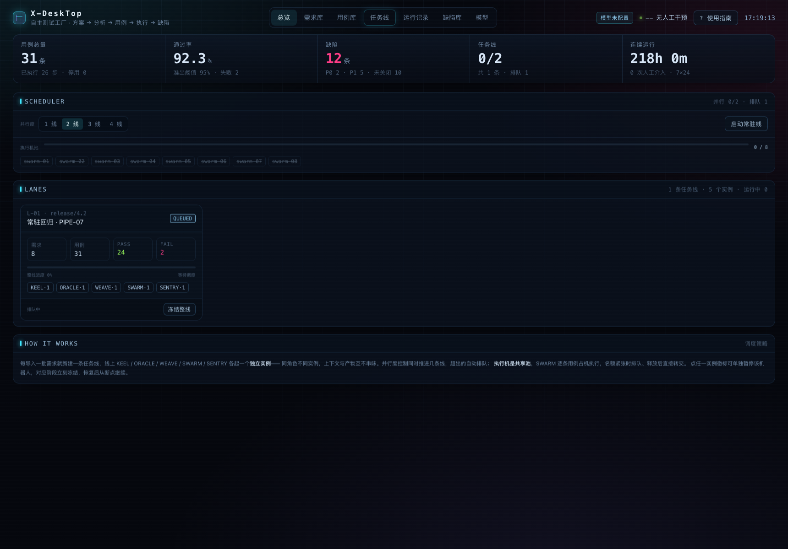
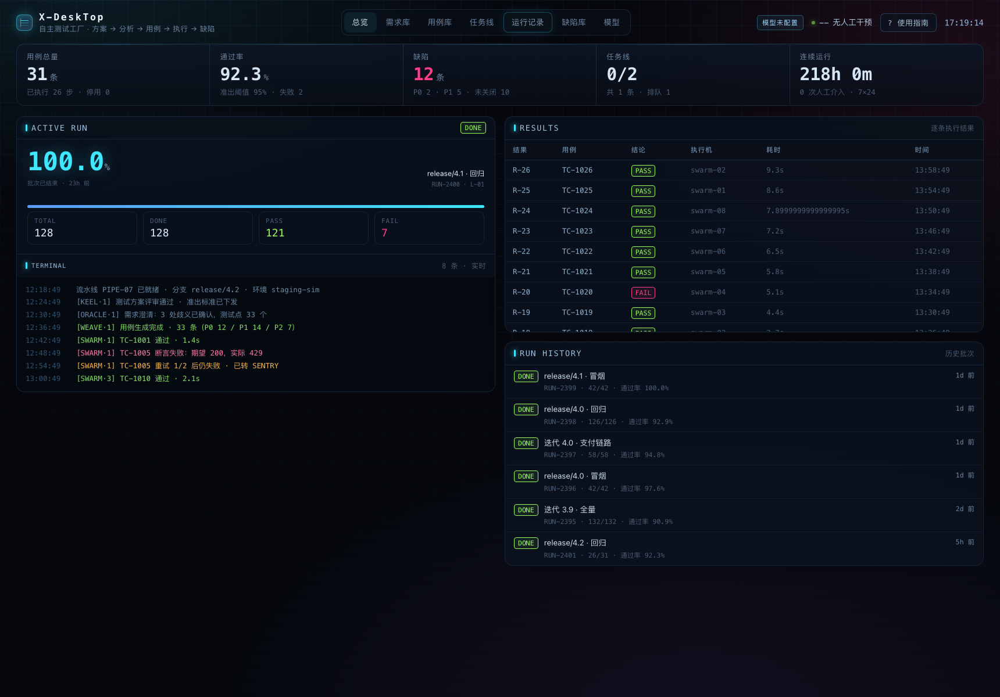
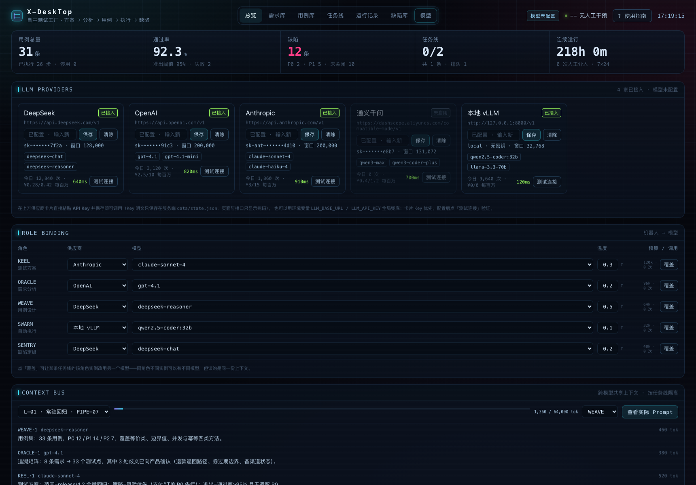

<div align="center">

# X-DeskTop

**7×24 自主软件测试工厂 · 赛博朋克风格的 AI 测试团队控制台**

导入需求后，5 个角色机器人接力完成 **测试方案 → 需求分析 → 用例设计 → 自动执行 → 缺陷定级** 全流程，多任务线并行、共享执行机池、跨模型共享上下文。

[](https://nodejs.org)
[](#-技术栈)
[](#-测试)
[](#-许可)
[](#-许可)

*纯原生 ES Module 前端 + Node 零依赖后端，克隆即跑，无需构建。*



</div>

## ✨ 特性

- 🏭 **全流程自动化** —— KEEL→ORACLE→WEAVE→SWARM→SENTRY 五角色接力，产物（方案/测试点/用例/执行结果/缺陷）实时回流
- 🚦 **真实门禁与调度** —— 暂停任意机器人该阶段就真的停；执行机池全局共享，占机/排队/并行度 1~4 可调
- 🧵 **多任务线并行** —— 每批需求一条线，同角色多实例（KEEL·2、KEEL·3…），上下文按线隔离
- 🔀 **换模型不换上下文** —— 供应商统一 OpenAI 兼容协议；角色级绑定 + 实例级覆盖；共享上下文超预算 55% 自动压缩
- ⚡ **纯真模型** —— 只调真实 LLM（DeepSeek / OpenAI / 通义 / OpenRouter / 本地 vLLM），无模拟回退，token 记账与失败原因全透明
- 🖥️ **2.5D 等距大屏** —— 纯 SVG 手绘流水线场景，SSE 实时驱动，无任何图表库

## 📸 界面

| 总览大屏 | 任务线 |
| --- | --- |
|  |  |
| **运行记录** | **模型配置** |
|  |  |

## 🚀 快速开始

```bash
git clone <your-repo-url> x-desktop && cd x-desktop
npm start              # 打开 http://localhost:8790
```

配置模型（二选一，页面配置更方便）：

```bash
# 方式一：模型页 → 供应商卡片 → 粘贴 API Key → 保存（即存即用）
# 方式二：环境变量
cp .env.example .env   # 填入 LLM_BASE_URL / LLM_API_KEY
```

> 📘 详细使用说明（界面导览 / 5 分钟试用 / FAQ）见 **[docs/USAGE.md](docs/USAGE.md)**，接口契约见 **[docs/API.md](docs/API.md)**。

## 🏗️ 架构

```
┌─────────────── 浏览器（web/，原生 ES Module，无构建） ───────────────┐
│  总览 2.5D 流水线 · 需求库 · 用例库 · 任务线 · 运行记录 · 缺陷库 · 模型 │
└────────────────  REST（快照/操作） + SSE（实时事件增量） ─────────────┘
┌──────────────────── 服务端（server/，Node ≥ 20，零依赖） ─────────────┐
│  app.mjs 路由/静态  ·  pipeline 五阶段状态机+调度  ·  llm 模型驱动     │
│  context 上下文总线  ·  events SSE 总线  ·  store JSON 原子持久化     │
└──────────────────────────────────────────────────────────────────────┘
```

**核心设计**

- **一份状态，多端视图**：服务端只有一份 `state`（JSON 落盘），前端首屏拉 `/api/snapshot`，之后靠 SSE 增量合并，25s 全量对齐防丢包
- **流水线 = 状态机**：阶段推进、门禁（gate）、执行机池名额全部真实生效
- **六段式 Prompt**：SYSTEM / MODEL / SHARED CONTEXT / PRIVATE MEMORY / TASK / OUTPUT CONTRACT，任何角色任何模型读到的上下文一致

## 🔧 技术栈

| 层 | 选型 |
| --- | --- |
| 前端 | 原生 ES Module · SVG 等距投影 · SSE · 零框架 |
| 后端 | Node ≥ 20 · 自研极简路由 · SSE · JSON 原子落盘 · 零 npm 依赖 |
| 模型 | OpenAI 兼容协议（DeepSeek / OpenAI / 通义 / OpenRouter / vLLM / Ollama） |
| 测试 | node:test 集成测试（导入→流水线跑完 / 门禁 / 并行度 / CRUD / 绑定） |

## 📁 目录结构

```
server/
  index.mjs            启动入口
  app.mjs              HTTP 服务：路由 + 静态托管 + CORS
  config.mjs           环境变量配置
  lib/http.mjs         极简路由器 / JSON / 静态文件
  domain/seed.mjs      种子数据（角色/供应商，确定性演示数据）
  store/store.mjs      JSON 持久化（data/state.json，原子写）
  services/llm.mjs     统一模型调用（仅真实模型，OpenAI 兼容）
  services/context.mjs 上下文总线（写入 / 压缩 / Prompt 组装）
  services/pipeline.mjs 五阶段流水线 + 调度器 + 执行机池
  services/snapshot.mjs 视图聚合（KPI / 阶段 / 团队 / 快照）
  routes/              system · requirements · cases · lanes · runs · defects · models
web/                   原生前端（同构视觉语言，无构建）
test/api.test.mjs      node:test 接口与流程测试
docs/                  USAGE.md 使用说明 · API.md 接口文档 · screenshots/
```

## 🧪 测试

```bash
npm test   # 覆盖：健康检查/快照结构、导入→流水线跑完、实例门禁、
           # 并行度校验、用例 CRUD、缺陷流转、模型绑定/覆盖/Prompt、404、静态页
```

## 📄 常用脚本

| 命令 | 说明 |
| --- | --- |
| `npm start` | 启动服务（http://localhost:8790） |
| `npm run dev` | --watch 开发模式 |
| `npm test` | 运行集成测试 |
| `npm run blank` | 清空全部业务数据（干净试用起点） |
| `npm run reset` | 重置回演示种子数据 |

## 🔒 隐私与安全

- API Key 只保存在服务端 `data/state.json` 或 `.env`，**均已 gitignore**，不会进入仓库
- 页面与接口永远只返回掩码（`sk-te••••••cdef`）
- 默认只监听 `127.0.0.1`，无登录体系，请勿直接暴露公网

## 📄 许可

MIT
